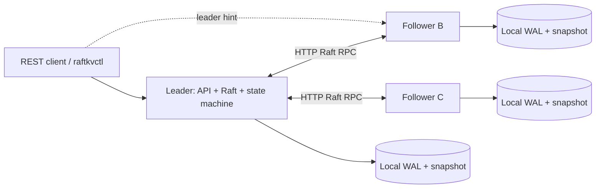

# RaftKV

RaftKV is a Go distributed key-value store with a Raft consensus engine written
from scratch. Three independent processes replicate an ordered log over HTTP,
acknowledge writes after majority commitment, and recover from local disk.
It uses only the Go standard library; there is no database or consensus dependency.

This is an engineering portfolio implementation with tested failure behavior,
not a claim of production readiness or a formally verified Raft implementation.



## Quick start

Install Go 1.24 or newer. Run commands from the repository root. Race detection
also requires a compatible C compiler; Linux GCC is the simplest setup. On
Windows, use a current MinGW-w64 GCC and put its `bin` directory on PATH.
No third-party Go modules are downloaded.

Windows PowerShell:

```powershell
# If Go is installed only in the workspace-local toolchain used for validation:
$env:PATH = "$PWD\.tools\go\bin;$env:PATH"
$env:GOCACHE = "$PWD\.cache\go-build"

powershell -ExecutionPolicy Bypass -File scripts/start-local.ps1
.\bin\raftkvctl.exe put greeting hello
.\bin\raftkvctl.exe get greeting
.\bin\raftkvctl.exe delete greeting
Invoke-RestMethod http://localhost:8001/v1/status

powershell -ExecutionPolicy Bypass -File scripts/stop-local.ps1
```

The Windows script runs hidden background processes and records their PIDs and
creation times in `data/local-processes.json`. Stop verifies identity before
terminating them. Windows script shutdown is abrupt and exercises crash recovery;
node data remains in `data/node1`, `data/node2`, and `data/node3`. Starting again
recovers that data. Do not start a second cluster on the same ports or directories.

Linux/macOS, first terminal:

```sh
sh scripts/start-local.sh
```

Second terminal:

```sh
./bin/raftkvctl put greeting hello
./bin/raftkvctl get greeting
./bin/raftkvctl delete greeting
curl -s http://localhost:8001/v1/status
```

Ctrl+C in the first terminal sends termination signals; the servers stop consensus,
drain HTTP handlers, and close their WALs. To run each node in its own terminal:

```sh
go run ./cmd/raftkv -config config/node1.json
go run ./cmd/raftkv -config config/node2.json
go run ./cmd/raftkv -config config/node3.json
```

Execute those three commands separately. Each node has a configurable ID,
listener, durable data directory, full membership map, and timing settings.
Membership is fixed and must agree across all nodes. Data directories are bound
to a node ID and a hash of membership, including addresses. Changing membership
or addresses is not a supported operation on existing data.

## Docker Compose

```sh
docker compose -f deploy/compose.yaml up --build -d
docker compose -f deploy/compose.yaml ps

# Run the leader-aware client INSIDE the Compose network:
docker compose -f deploy/compose.yaml exec node1 raftkvctl \
  -seeds http://node1:8000,http://node2:8000,http://node3:8000 put greeting hello
docker compose -f deploy/compose.yaml exec node2 raftkvctl \
  -seeds http://node1:8000,http://node2:8000,http://node3:8000 get greeting

docker compose -f deploy/compose.yaml down
```

Named volumes retain data across `down` and `up`. `down -v` destroys cluster data.
Host ports 8001–8003 allow status inspection. Leader URLs in this deployment use
container DNS names, so run the discovery client inside the Compose network.
Docker was unavailable on the implementation host; the Compose deployment is
provided but has not been executed there. Native Windows processes were tested.

## HTTP API

| Endpoint | Request | Success |
|---|---|---|
| `PUT /v1/kv/{key}` | JSON `{"value":"hello"}` | `204` after majority commit |
| `GET /v1/kv/{key}` | No body | `200` JSON `{"key":"greeting","value":"hello"}` |
| `DELETE /v1/kv/{key}` | No body | `204`, including absent keys |
| `GET /v1/status` | No body | `200`, local operational status |
| `GET /healthz` | No body | `200` if locally alive; `503` for storage failure |

Keys contain 1–1024 bytes; values are UTF-8 JSON strings of at most 64 KiB.
Percent-encode keys in paths. PUT rejects unknown fields, missing/null values,
invalid JSON, trailing data, and oversized input. Public operations have a
configurable deadline. HTTP header, body, idle, and write timeouts are bounded.

| Status | Meaning |
|---|---|
| `400` | Invalid request |
| `404` | Key absent after a committed read barrier |
| `405` | Unsupported method |
| `409` | Wrong node; JSON contains `leader` and `leader_url` when known |
| `503` | Stopped/failed node or consensus unavailable |
| `504` | Operation deadline expired before a successful result |

Example Bash requests, after finding the leader with `/v1/status`:

```sh
curl -i -X PUT http://localhost:8001/v1/kv/greeting \
  -H 'Content-Type: application/json' -d '{"value":"hello"}'
curl -i http://localhost:8001/v1/kv/greeting
curl -i -X DELETE http://localhost:8001/v1/kv/greeting
```

Substitute the current leader's port. A follower returns a hint for reads and
writes; it does not serve an unconfirmed local value. `raftkvctl` and
`internal/client` try configured seeds, follow hints only to configured addresses,
retry temporary errors, and obey an overall deadline. The shared client is safe
for concurrent calls. A call without a deadline receives a five-second default.

## Consensus and consistency

Election timers are randomized independently. A candidate increments its term,
persists its self-vote, and requests votes. A node grants at most one vote per
term and only to a candidate with an equally up-to-date or newer log. A new
leader appends a current-term no-op to make inherited entries committable.
Higher-term requests and responses cause durable term advancement and step-down.

For a write, the leader persists the entry, replicates it, and advances commitment
only when a majority has stored a current-term entry. Committing that entry also
commits its prefix. Followers check the previous index and term, replace only
conflicting uncommitted suffixes, and durably store changes before acknowledging.
The state machine applies committed entries in index order under the Raft mutex.

**Reads use a log-backed quorum-confirmed barrier.** Each GET appends a read entry
in the current term and waits for its majority commitment and application before
reading the map. This confirms a quorum after the read arrived, without clock
leases or an assumption that a leader remains authoritative. An isolated former
leader can neither acknowledge a fresh write nor complete a fresh read. Reads
consume WAL and replication bandwidth; this implementation does not optimize
them with ReadIndex or batching.

Successful individual operations are designed to be linearizable under Raft's
non-Byzantine assumptions. Availability requires a communicating majority: two
of three nodes can progress; one cannot. Health and status are local diagnostics,
not linearizable reads or proof that a node can commit operations.

Timeouts, disconnects, and leadership changes produce **unknown outcomes**: an
entry can commit after its caller gives up. Retrying PUT/DELETE can apply the
operation again, including after intervening writes. There are no request IDs,
deduplication, transactions, compare-and-swap, or exactly-once client guarantees.

## Persistence and recovery

Each node owns its directory through an OS file lock released automatically on
process exit. `raft.wal` contains append-only, length-framed, CRC32-protected
JSON recovery images. Each image includes term, vote, commit index, log suffix,
and a state-machine snapshot. A full image per durable update makes suffix
replacement and snapshot recovery atomic at record boundaries, at the cost of
write amplification. Idle heartbeats do not append unchanged images.

Writes and votes are file-synced before protocol acknowledgement. On restart,
recovery scans the WAL, truncates an incomplete final record, rejects checksum
corruption, restores the snapshot, and replays committed suffix entries. The
persisted commit index also allows recovery before the next leader heartbeat.

After `snapshot_threshold` applied entries (including barriers/no-ops), the node
captures the map and last included index/term, writes a synced `snapshot.bin`,
and replaces the WAL with a synced compacted recovery image. Rename publication
means a process crash leaves an old or new usable WAL. The WAL includes its
snapshot payload, so recovery has no cross-file pointer dependency; the separate
snapshot is an inspection/checkpoint artifact. A lagging follower receives a
complete snapshot through InstallSnapshot, then resumes ordinary replication.

File synchronization and checksums do not protect against dishonest hardware,
arbitrary disk corruption, or loss of a majority's storage. POSIX directory
publication is synced; Windows directory rename power-loss durability is not
claimed. Tests establish abrupt **process-crash** recovery, not power-failure
durability across all filesystems. Pre-provision reliable local data directories.
Storage errors fail the node closed; repair/recovery needs operator action.

## Failure demonstrations

Automated tests use real loopback HTTP, separate WAL directories, synchronized
network-link filters, explicit process termination, and bounded condition polling.
There are no fake acknowledgements or in-memory substitutes in integration tests.

```sh
go test ./... -count=1 -timeout=120s
go test -race ./... -count=1 -timeout=180s
go vet ./...
go test ./tests -run TestPartition -v -count=1
go test ./tests -run TestProcessKill -v -count=1
go test ./tests -run TestLeaderFailure -v -count=1
go test ./tests -count=10 -timeout=240s
```

| Test | Behavior exercised |
|---|---|
| `TestHealthyHTTPAndConcurrentClients` | Healthy quorum, cross-node discovery, PUT/GET/DELETE, 24 concurrent writes |
| `TestLeaderFailureSnapshotCatchupAndFullRestart` | Leader loss, replacement, writes with two nodes, lagging follower snapshot transfer, full restart |
| `TestPartitionMinoritySafetyAndConflictingSuffixRepair` | Isolated leader read/write rejection, majority progress, suffix repair, all-links outage and healing |
| `TestProcessKillLeaderAndWholeClusterRecovery` | Abrupt OS process kill, new leader, continuing writes, node restart, whole-cluster crash/recovery |
| `internal/raft` unit tests | Vote persistence, freshness, no double voting, consistency checks, current-term commit rule, fail-closed storage |
| `internal/storage` unit tests | Torn WAL tail, checksum corruption, compaction recovery, exclusive directory lock |

Manual Docker failure drill:

1. Inspect `http://localhost:8001/v1/status` (and ports 8002/8003) to identify the leader.
2. `docker compose -f deploy/compose.yaml kill node2` (replace `node2` with that leader).
3. Use `raftkvctl` inside a surviving container to write and read a new key.
4. `docker compose -f deploy/compose.yaml start node2`; inspect its applied index until it catches up.
5. Stop two nodes; a surviving node cannot acknowledge new operations before deadlines.
6. Start them again and verify earlier acknowledged data.

On Windows, use the recorded PID in `data/local-processes.json` with
`Stop-Process -Id PID -Force` for the same crash drill, then restart that node
with `.\bin\raftkv.exe -config config/nodeN.json` in a terminal. A manually
restarted process is not included in the script's existing PID record.

## Operational status and limitations

`/v1/status` reports node ID, role, term, known leader and URL, commit/applied/log
indices, snapshot boundary, leader-side peer match indices, election count, and
Raft operation count. Counters reset at process restart. Structured JSON logs
record startup, elections, and fail-closed storage errors. There is no Prometheus
endpoint, tracing, or readiness/quorum health probe.

Fixed membership supports three or more members; odd counts are preferable.
There is no membership reconfiguration, pre-vote, check-quorum step-down, TLS,
RPC authentication, authorization, encryption at rest, rate limiting, backup
automation, or disaster recovery after majority data loss. RPCs assume trusted
peers on a private network. Do not expose these ports to untrusted networks.

The map and snapshots fit in memory. The WAL stores full recovery images, with a
256 MiB record/RPC ceiling; state must stay comfortably below that limit. Disk
I/O and application run under one mutex, snapshot transfer is whole-image,
replication batches contain at most 64 entries, and retry backtracking is linear.
This favors auditability over throughput. No benchmark or sustained production
load qualification is claimed. See [the architecture document](docs/architecture.md)
for component boundaries and invariants, and [validation notes](docs/validation.md)
for the recorded execution environment.

Protocol reference: [Ongaro and Ousterhout, extended Raft paper](https://raft.github.io/raft.pdf),
especially Figure 2, log compaction, and the read-only operation discussion.
